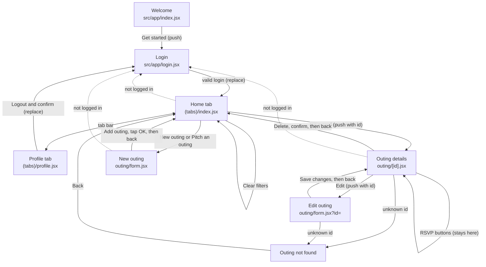

# Screen flow

This diagram shows how you move between the screens of the app.

Push is the normal way of going forward. The Android back button takes you back to the screen before.

Replace removes the old screen, so you can't go back to it. After logging in, pressing back on Home closes the app instead of going back to the login screen. After logging out, pressing back doesn't take you back into the app.

The back buttons in the app go to the previous screen if there is one. If there isn't, they take you to Home.

The dotted lines show that these screens check if someone is logged in, and send you to the login screen if not.
