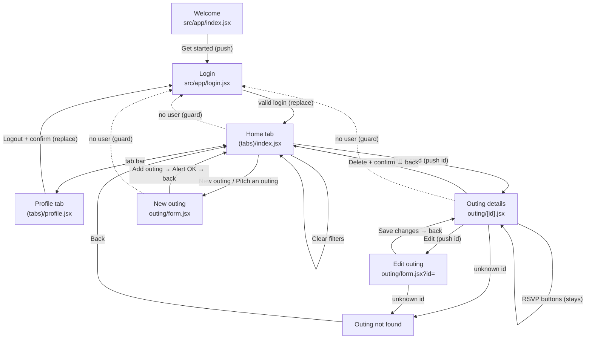

# Screen flow

- **push** = normal forward navigation, Android back returns to the previous screen.
- **replace** = the old screen is removed, so back can't return to it (after login: back on Home exits the app; after logout: back can't re-enter the app).
- Back buttons use `router.back()` when possible, otherwise `router.replace("/(tabs)")`.
